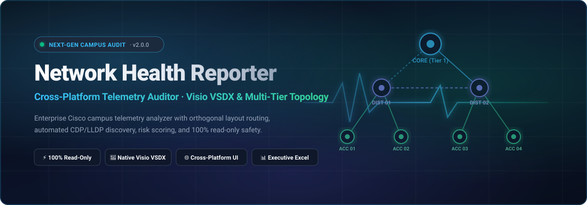

<div align="center">

<br>


# Network Health Reporter

### Enterprise Campus Network Health Auditor & Multi-Tier Topology Analyzer

<br>

[](https://github.com/LazyAutomatar/Network-Health-Reporter/releases)
[](LICENSE.md)
[](LICENSE.md)
[](https://github.com/LazyAutomatar/Network-Health-Reporter/releases)
[](https://github.com/LazyAutomatar/Network-Health-Reporter/releases)
[](https://dotnet.microsoft.com/)

<br>

[**Download**](#download) · [**Features**](#features) · [**Screenshots**](#screenshots) · [**Hardware Support**](#supported-hardware) · [**Telemetry Commands**](#telemetry--commands-guide) · [**Changelog**](CHANGELOG.md) · [**Release Control & Tags**](#release-control--tagging) · [**Architecture**](#architecture) · [**Feedback & Issues**](#feedback--support) · [**License & EULA**](#license)

<br>

<a href="https://github.com/LazyAutomatar/Network-Health-Reporter/releases"></a>
<a href="https://github.com/LazyAutomatar/Network-Health-Reporter/releases"></a>
<a href="https://github.com/LazyAutomatar/Network-Health-Reporter/releases"></a>
<a href="https://github.com/LazyAutomatar/Network-Health-Reporter/releases"></a>

</div>

> [!IMPORTANT]
> **100% Non-Invasive & Read-Only Safety**: Network Health Reporter strictly operates on non-disruptive `show` commands and offline CLI log files. It does **not** make configuration changes, execute write transactions, or impact control-plane traffic. Safety is enforced by a hardcoded `CommandGuard` interceptor.

---

<div align="center">

</div>

---

## <a id="screenshots"></a>Screenshots & Previews
<sub>Drop your actual screenshots into <code>assets/screenshots/</code> to replace the preview cards below.</sub>

| 🗺️ Campus Topology & Orthogonal Routing | 📊 Executive Health Dashboard |
| :---: | :---: |
| <br><sub><em>Live draggable nodes, marquee multi-select, and Visio-style port labels</em></sub> | <br><sub><em>0–100 Weighted Site Score, category breakdowns, and real-time finding feeds</em></sub> |

---

## <a id="features"></a>Features

### 🗺️ Multi-Tier Topology & Diagramming
* **Automated Campus Hierarchy** — Automatically categorizes nodes into **Tier 1 (Core)**, **Tier 2 (Distribution)**, and **Tier 3 (Access)** with dedicated WLC and endpoint layers.
* **Orthogonal Bus Routing** — Non-overlapping Manhattan routing with 80px channel separation, preventing line collisions across dense enterprise switches.
* **Multi-Token 25G/40G/100G Port Parser** — Accurately pairs high-speed uplink interfaces (`Twe`, `Ten`, `Fo`, `Hu`, `Gig`) across wrapped tabular CDP/LLDP tables.
* **Interactive Avalonia Canvas** — Multi-node marquee box selection, Ctrl+Click selection, dragging, edge auto-scrolling, and dynamic canvas auto-expansion.
* **Direct Visio VSDX Exporter** — Generates genuine Microsoft Visio (`.vsdx`) XML drawings with official network master stencils and shape properties.

### 🩺 Deep Telemetry & Risk Scoring
* **0–100 Weighted Site Score** — Instant macro-level health indicator computed across Switching, Wireless RF, Topology, and Safety categories.
* **STP & Loop Prevention** — Verifies Root Bridge placement, flags suboptimal priority bridges, and validates BPDU Guard / PortFast compliance.
* **VLAN & MTU Discrepancy Checks** — Detects trunk native VLAN mismatches, MTU mismatches, and asymmetric trunk link configurations.
* **Hardware & PoE Budgets** — Audits dual power-supply redundancy, fan module states, and PoE capacity per stack member.
* **Wireless RF Health** — Audits Cisco Catalyst 9800 / AireOS controllers, AP channel utilization, co-channel interference, and client distribution.

### 💻 Cross-Platform Native Experience
* **Modern Avalonia Desktop UI** — Fluent dark slate aesthetic with responsive layouts, acrylic blur, and vector iconography.
* **True Multi-Platform** — Native self-contained binaries for **Windows 10/11**, **macOS Apple Silicon (M1/M2/M3/M4)**, **macOS Intel**, and **Linux (x64 & ARM64)**.
* **Zero Runtime Dependencies** — Ships as standalone self-contained executables; no separate .NET installation required.

### 🔄 In-App Auto-Updates & Enterprise Security
* **One-Click Update Checker** — Checks the official release manifest on GitHub from the **About** view and installs the update in one click.
* **In-Place Upgrade & Progress** — Streams update installer packages with live progress bars and transparent status messaging.
* **Cryptographic Verification** — Validates downloaded binary SHA-256 hashes against trusted release manifests prior to execution.
* **PE Header Safety Interceptor** — Validates Win32 executable magic byte signatures (`MZ`) before staging or running setup.
* **Authenticode Digital Signatures** — Binaries and setup wizards are digitally signed with Conventus Technologies publisher identity to verify authenticity and minimize SmartScreen prompts.

### 📊 Executive Deliverables & Ingestion
* **Offline Log Parser** — Audit air-gapped networks effortlessly by uploading arbitrary CLI show command outputs or batch log files.
* **Live SSH Audit** — Live polling with DPAPI-encrypted credential vault and Dry-Run safety verification mode.
* **Handover Excel Exporter (`.xlsx`)** — 6 pre-formatted executive worksheets (Audit Summary, Topology Matrix, Full Hardware Inventory, Best Practices, and Findings).
* **Executive PDF Report** — C-level PDF audit report with embedded high-resolution vector diagrams and prioritized action plans.

---

## <a id="download"></a>Download & Installation

Get the latest production release for your platform from the [**GitHub Releases**](https://github.com/LazyAutomatar/Network-Health-Reporter/releases) page.

| Platform | Package | Architecture | Description |
| :--- | :--- | :--- | :--- |
| **Windows** | `NetworkHealthReporter.exe` | x64 (64-bit) | Portable single-file executable (no install required) |
| **Windows** | `NetworkHealthReporter_Setup.exe` | x64 (64-bit) | Standard Windows Installer with Desktop & Start Menu shortcuts |
| **Windows** | `NetworkHealthReporter-win-x64.zip` | x64 (64-bit) | Portable zip archive |
| **macOS** | `NetworkHealthReporter-osx-arm64.zip` | Apple Silicon (M1/M2/M3/M4) | Native `.app` bundle optimized for Apple Silicon |
| **macOS** | `NetworkHealthReporter-osx-x64.zip` | Intel x64 | Native `.app` bundle for Intel Macs |
| **Linux** | `NetworkHealthReporter-linux-x64.tar.gz` | x64 (AMD64) | Tarball with desktop launcher & installer script |
| **Linux** | `NetworkHealthReporter-linux-arm64.tar.gz` | ARM64 (aarch64) | Tarball for ARM64 Linux systems (e.g. Raspberry Pi 5) |

### Quick Start by OS

#### Windows
Simply download `NetworkHealthReporter.exe` and double-click to launch. Alternatively, download and run `NetworkHealthReporter_Setup.exe` for system integration.

#### macOS
1. Download `NetworkHealthReporter-osx-arm64.zip` (for M-series Macs) or `-osx-x64.zip` (for Intel Macs).
2. Extract the archive and drag `NetworkHealthReporter.app` to your `/Applications` folder.
3. If macOS displays an unidentified developer prompt on first launch, open Terminal and run:
   ```bash
   xattr -cr /Applications/NetworkHealthReporter.app
   ```

#### Linux
1. Download and extract the archive:
   ```bash
   tar -xzf NetworkHealthReporter-linux-x64.tar.gz
   cd NetworkHealthReporter-linux-x64
   chmod +x NetworkHealthReporter
   ./NetworkHealthReporter
   ```
2. *(Optional)* Run `./install.sh` to install to `~/.local/bin` and create an application launcher.

---

## <a id="supported-hardware"></a>Supported Hardware

Network Health Reporter parses standard Cisco IOS, IOS-XE, and AireOS telemetry across modern and legacy campus infrastructure:

* **Core & Distribution Layer**: Cisco Catalyst 9600, 9500, 9400, 9300X, 6800, 6500 series, Cisco Nexus 9000/7000 (campus core mode).
* **Access Layer**: Cisco Catalyst 9300, 9200, 9200L, 9200CX, 3850, 3650, 2960-X, 2960-XR, 3560-CX series.
* **Wireless Controllers (WLC)**: Cisco Catalyst 9800 Series (9800-80, 9800-40, 9800-L, 9800-CL virtual), Cisco 5520, 3504, 8540 AireOS Controllers.
* **Access Points**: Cisco Catalyst 9100 Series (9105, 9115, 9120, 9124, 9130, CW9162/64/66), Cisco Aironet 1800/2800/3800/4800 Series.
* **Endpoints & Telephony**: Cisco Unified IP Phones (7800, 8800, 7900 series), Video Webex endpoints, connected IoT gateways.

---

## <a id="telemetry--commands-guide"></a>Telemetry & Commands Guide

For **Offline Audits**, save the outputs of the following standard Cisco CLI commands from your core switch and access switches into `.txt` or `.log` files, then drop them into the app:

```csharp
show version
show cdp neighbors detail
show cdp neighbors
show lldp neighbors detail
show running-config
show ip route
show interfaces status
show interfaces description
show spanning-tree summary
show power inline
show environment power
show environment fan
show ap summary                  // (On WLC or Mobility Express)
show wireless client summary     // (On WLC)
```

> [!TIP]
> The parser automatically extracts the device hostname, management IP, model platform, and uplink paths even if all commands are concatenated into a single master log file.

---

## <a id="release-control--tagging"></a>Release Control & Versioning

Releases are governed by strict [Semantic Versioning (SemVer)](https://semver.org/) and automated through Git release tags:

```
v<MAJOR>.<MINOR>.<PATCH>  (e.g., v2.0.0, v2.1.0)
```

### Creating & Publishing a New Release

To publish a new official release with automated multi-platform builds:

1. **Tag the commit**:
   ```bash
   git checkout main
   git pull origin main
   git tag -a v2.0.3 -m "Release v2.0.3"
   git push origin v2.0.3
   ```
2. **Automated GitHub Actions Pipeline**:
   * Pushing a tag matching `v*` triggers [`.github/workflows/release.yml`](.github/workflows/release.yml).
   * The pipeline verifies all 262 unit tests, compiles the cross-platform binaries, generates setup installers, and publishes the release on GitHub with changelog notes and attached release binaries.

3. **Local Release Pipeline**:
   To generate all release binaries locally without CI:
   ```powershell
   ./publish-all.ps1 -Configuration Release
   ```
   All packages are placed in the `dist/` directory ready for distribution.

---

## <a id="architecture"></a>System Architecture & Capabilities

The application engine is engineered into cleanly decoupled, test-driven .NET 8 modules:

```
Network Health Reporter/
├── NetHealth.Core/             # Telemetry parsing, discovery agents, topology bridge, anomaly scoring
│   ├── Agents/                 # DiscoveryAgent (CDP/LLDP), SwitchingAgent, WirelessAgent, SynthesisAgent
│   ├── Analysis/               # OfflineLogParserService (Batch log parser, multi-tier uplink resolution)
│   ├── Reporting/              # Visio VSDX Exporter, Handover Excel Exporter, PDF Generator
│   ├── Schemas/                # Data contracts (DiscoveryContract, SwitchingContract, WirelessContract)
│   └── Topology/               # GraphEngine, TopologyBridge, DiagramLayoutEngine (Manhattan bus routing)
├── NetHealth.Desktop/          # Avalonia UI Native Cross-Platform Application (Windows, macOS, Linux)
│   ├── Views/                  # MainWindow, DashboardView, TopologyView, AuditView, SettingsView
│   ├── ViewModels/             # ReactiveUI MVVM ViewModels
│   └── Assets/                 # High-resolution vector assets, app icon (.ico / .png)
├── NetHealth.Tests/            # Comprehensive xUnit test suite (262 tests covering all engines)
├── docs/                       # Documentation, architecture specs, and GitHub Pages website
└── dist/                       # Output directory for compiled multi-platform release packages
```

---

## <a id="feedback--support"></a>Feedback & Issue Reporting

Network Health Reporter is a closed-source freeware tool maintained for the network engineering community. While the source codebase is proprietary, the software is public and **100% free for everyone**.

We welcome user feedback, bug reports, and hardware requests:

1. **Report Bugs & Regressions:** Open a ticket on our [GitHub Issue Tracker](https://github.com/LazyAutomatar/Network-Health-Reporter/issues).
2. **Request Hardware & Command Support:** If you have newer switch platforms (e.g. Cisco Catalyst 9600 Sup-2) or specific WLC models, submit sanitized CLI show command snippets via GitHub Issues.
3. **Feature Requests:** Share ideas for new reporting formats, scoring rules, or topology visualizers.

---

## <a id="license"></a>License & Terms of Use

Network Health Reporter is provided as **Closed Source Freeware — Free for Personal and Commercial Enterprise Use**. 

You are free to download, install, run, and distribute unmodified binary copies of this software across your organization without license fees or subscription costs. See the [LICENSE.md](LICENSE.md) and [EULA.txt](EULA.txt) files for complete terms of use.

<div align="center">
<br>
<sub>Crafted with precision for enterprise network engineering teams worldwide.</sub>
</div>
